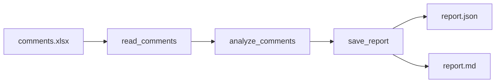

# 电商评论语义分析 Agent

把 Excel 里的买家评论，自动整理成运营同事可以直接使用的分析报告。

> 输入一张评论表，输出「情感分布 + 主题归因 + 风险等级 + 运营建议」的结构化报告。

## 业务问题

> 以下是基于电商运营常见工作流的假设，尚未做真实用户访谈；入职后会先用 3–5 位运营同事验证。

**目标用户**：电商店铺的运营专员，日常负责商品评价维护、差评跟进和周报。

**现在的做法**：从店铺后台导出评论 Excel，逐条浏览，凭经验按“质量 / 物流 / 客服”归类，再把典型差评复制到周报。100 条评论大约要 1–2 小时。

**三个痛点**：

1. 评论是非结构化文本，人工归类口径不一致，换个人结果就不一样；
2. 差评发现滞后，往往等评分下滑才开始排查；
3. 周报只能写“感觉质量投诉变多了”，缺少可量化的依据。

**一句话介绍**：把运营从“逐条读评论”里解放出来，1 分钟内得到一份可量化、可直接转发的评论洞察报告。

**使用边界**：工具只做“发现与分诊”，不替代客服处理投诉；高风险评论仍由人工复核。

## 核心功能

- **读取评论表**：识别 `评论ID / 商品名称 / 评分 / 评论内容 / 评论时间` 等列，兼容常见表头别名
- **情感分析**：判定正面 / 中性 / 负面，并给出情感得分
- **主题归因**：把评价落到质量做工、尺码版型、物流包装、客服售后、价格性价比、外观颜色、穿着体验七个主题
- **风险识别**：结合评分、强烈负面词和售后诉求，标记高 / 中 / 低风险
- **运营建议**：按负面主题自动生成可执行的改进动作
- **双格式报告**：JSON 供系统消费，Markdown 供人阅读

## 快速开始

```bash
pip install -r requirements.txt
python analyze.py --offline
```

有 OpenAI 兼容接口的 API Key 时，可启用大模型工具调用：

```powershell
$env:OPENAI_API_KEY="sk-xxx"
$env:OPENAI_MODEL="gpt-4o-mini"
python analyze.py
```

也支持 `DEEPSEEK_API_KEY`，或通过项目根目录的 `.env` 配置。

## 输出示例

运行后在 `reports/` 下生成：

- `comment_analysis_YYYYMMDD_HHMMSS.json`：完整结构化数据
- `comment_analysis_YYYYMMDD_HHMMSS.md`：可直接转给业务同事的报告

示例报告见 [`docs/sample_report.md`](docs/sample_report.md)。

## 技术方案



三个工具共享同一个会话状态，避免把整张评论表在模型上下文里反复搬运：

| 工具 | 作用 | 关键设计 |
| --- | --- | --- |
| `read_comments` | 读取并清洗 Excel | 表头别名匹配、空行过滤、类型归一化 |
| `analyze_comments` | 语义分析与聚合 | 情感词典 + 否定词处理 + 分句级主题归因 |
| `save_report` | 落盘报告 | JSON（结构化）+ Markdown（可读） |

**两种运行模式：**

- **LLM 模式**：通过 function calling，由模型按 `读取 -> 分析 -> 保存` 的顺序编排工具
- **离线模式**：没有 API Key 时，同一套工具由规则引擎按固定流程执行，保证可运行、可演示

模型漏调工具时，代码会自动补齐分析与保存步骤，避免“聊完了但没有产物”。

## 需求拆解与设计取舍

- **为什么先做 Excel 而不是接电商后台？** 运营同事的实际工作流就是导出表格，先把入口对齐，减少接入成本。
- **为什么保留离线模式？** 内部工具首先要稳定可用；模型不可用时仍能产出报告，也方便测试。
- **为什么同时输出 JSON 和 Markdown？** JSON 便于后续接入 BI/数据库，Markdown 便于非技术同事直接阅读。
- **为什么按主题归因而不是只给一个总分？** 运营需要的不是“好评率 80%”，而是“哪一类问题在拉低口碑、该找谁改”。

## 验证方式

当前用 5 条覆盖好评 / 中评 / 差评的模拟评论做端到端自测，结果与预期一致；同时记录了开发中的两次误判修正（见下方「迭代记录」）。

**下一步的真实业务验证方案：**

- 请运营同事独立标注 50–100 条评论，作为黄金集；
- 统计情感判定的准确率和混淆矩阵，目标 ≥ 85%；
- 抽查主题归因，目标 ≥ 80%；
- 记录 100 条评论的端到端耗时，目标 < 5 分钟；
- 高风险评论要求 100% 召回，允许人工复核误报。

示例数据结果：

- 5 条评论，平均评分 3.2
- 正面 2 条 / 中性 1 条 / 负面 2 条
- 质量做工负面提及最多，风险等级为「高」

> 当前结果仅代表模拟数据上的流程验证，不代表真实业务效果。

## 目录结构

```text
.
├── analyze.py              # 智能体与工具实现
├── comments.xlsx           # 示例评论数据
├── requirements.txt        # 依赖
├── README.md
├── docs/
│   ├── code_walkthrough.md # 代码走读手册
│   └── sample_report.md    # 示例报告
└── reports/                # 运行时生成（已加入 .gitignore）
```

## 迭代记录

**v1 → v2：修复负面词权重方向错误**

第一版把负面词也写成了正数权重，导致差评被误判为正面。抽查 5 条样本时发现 C005（1 星差评）得分异常，定位到词表符号问题；改为「正面 / 负面词表分开，合并时统一取负」，并补充了否定词处理。

**v2 → v3：修复“收到货”误判为物流问题**

C002 的“收到货发现线头”被归因到“物流包装”，因为关键词表里包含“到货”。实际这里表达的是商品质量问题，不是物流问题。修复方式是移除歧义关键词，并改为按分句做主题归因，避免一句话里多个主题互相污染。

## 已知局限与后续计划

- 规则引擎对反讽、隐喻和行业黑话的识别有限，后续可引入大模型逐条分析
- 当前是单文件脚本，尚未接入数据库和定时任务
- 后续计划：批量分析多商品、差评预警、人工复核闭环、简单的 Web 上传界面

## 作者贡献

【待补充：需求拆解、数据清洗、工具设计、规则引擎、测试验证、文档整理等具体分工】
